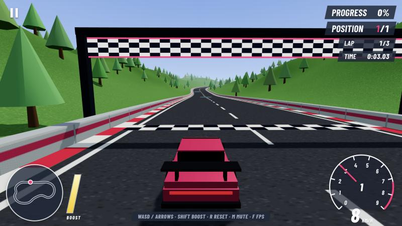
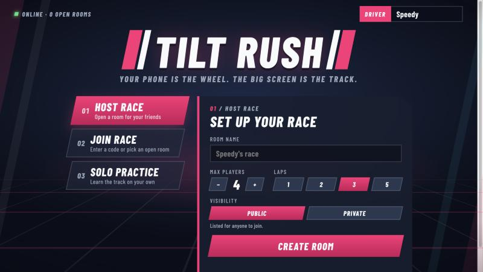

<div align="center">

# 🏁 Tilt Rush

**Multiplayer 3D arcade racer for the browser.**
The big screen shows the race. Your phone is the steering wheel.




</div>

---

## 📑 Contents

- [Features](#-features)
- [Screenshots](#-screenshots)
- [Tech stack](#-tech-stack)
- [Getting started](#-getting-started)
- [Controls](#-controls)
- [Testing](#-testing)
- [Project structure](#-project-structure)
- [How it works](#-how-it-works)
- [Roadmap](#-roadmap)

---

## ✨ Features

- 📱 **Phone as a controller** – scan a QR code, tilt to steer, thumbs for gas and brake. No app install.
- 🏎️ **Real-time multiplayer** – public or private rooms with short join codes, live positions and lap validation.
- ⚙️ **Proper car physics** – Rapier raycast-vehicle at a fixed 120 Hz with suspension, grip and boost.
- 🗺️ **Data-driven tracks** – road, kerbs, barriers, colliders, sectors, start grid and minimap are all generated from a list of control points.
- 🔁 **Resilient sessions** – displays and phones reconnect on their own after a reload, dropout or even a server restart.
- 🎮 **Solo practice** – learn the track alone, with a phone or the keyboard.
- 📉 **Adaptive rendering** – drops resolution, then shadows, when the frame rate dips so input stays snappy.

## 🖼️ Screenshots

| Lobby | In race |
|---|---|
|  |  |

## 🧰 Tech stack

| Layer | Technology |
|---|---|
| Language | **TypeScript** across client, server and shared code |
| Rendering | **Three.js** |
| Physics | **Rapier 3D** (`@dimforge/rapier3d-compat`, WASM) |
| UI | **React 19** |
| Build / dev server | **Vite** (HTTPS on LAN via `@vitejs/plugin-basic-ssl`) |
| Multiplayer | **Colyseus** rooms + `@colyseus/schema` state sync over WebSockets |
| Server | **Node.js** + **Express**, run with **tsx** |
| Phone pairing | **qrcode**, DeviceOrientation (tilt) API |
| Monorepo | **pnpm workspaces** |
| Testing | **Vitest** |
| Remote access (optional) | **Cloudflare quick tunnel** (`cloudflared`) |

## 🚀 Getting started

### Prerequisites

- Node.js 20+
- pnpm
- A phone on the same Wi-Fi (optional – the keyboard works too)

### Install and run

```bash
pnpm install
```

```bash
pnpm dev
```

That starts three things:

| What | Where | For |
|---|---|---|
| Game server (rooms) | `localhost:2567` | Colyseus; both web servers proxy to it under `/colyseus` |
| Display | `http://localhost:5173` or `http://<your-ip>:5173` | The computer, TV or any device on the Wi-Fi |
| Phone / LAN | `https://<your-ip>:5174` | What phones and other players on your Wi-Fi open |

Open `http://localhost:5173`, create a room, and scan the QR code in the lobby with your phone.

> **First time on a phone:** the LAN server uses a self-signed certificate (motion sensors only work over HTTPS), so the phone shows a warning once – choose to proceed. On iPhone, tap **Tap to connect** and allow motion access. The phone must be on the same Wi-Fi as the computer.

The same QR code is on the **Solo practice** screen, so you can try the phone without creating a room.

### If the phone can't open the link

A VPN, guest Wi-Fi or firewall can hide your computer from other devices. Pause the VPN, or stop `pnpm dev` and run:

```bash
pnpm dev:tunnel
```

This opens a Cloudflare quick tunnel (needs `cloudflared`) and sends phones to a public HTTPS address with a real certificate. While it runs, anyone with the random URL can reach your dev build, and input has a little more latency than on the LAN.

## 🎮 Controls

| Input | Phone | Keyboard |
|---|---|---|
| Steer | Tilt | `A` / `D` or `←` / `→` |
| Throttle / brake | Thumb buttons | `W` / `S` or `↑` / `↓` |
| Boost | Boost button | `Shift` or `Space` |
| Reset car | – | `R` |
| Mute | – | `M` |
| Show FPS | – | `F` |

While a phone is connected it takes over from the keyboard.

## 🧪 Testing

```bash
pnpm test
```

```bash
pnpm typecheck
```

`pnpm test` covers the shared lap/track/tilt logic and runs the room server end to end over real WebSockets: create/join, public/private, player limit, phone pairing, a full race and rematch.

## 📁 Project structure

```
apps/client       Vite + React + Three.js
  src/game        engine: loop, Rapier car physics, track scene, camera, remote-car interpolation
  src/ui          HUD, banner, race stage
  src/screens     home, lobby/race/results, solo practice
  src/pad         phone controller page
apps/server       Colyseus room server
  src/rooms       RaceRoom (phases, lap validation, positions, pad relay) and its state schema
packages/shared   track data + path maths, lap rules, tilt mapping, message protocol
scripts           dev tunnel helper
```

## 🔧 How it works

- **Client-side car, server-side result.** Each display simulates its own car (no input lag) and reports its transform 20 times a second. Other cars are drawn 100 ms in the past, blended between snapshots. The server decides everything that affects the result: phases, lap validation by sector order, live positions and finish times.
- **Phone pairing.** A phone joins the same room as a *pad*, bound to one player by a token in the QR link. Its input is forwarded straight to that player's display. One phone per car: the newest phone to open the link takes over, and a phone that reloads or loses signal rejoins by itself.
- **Recovery.** A display that reloads, crashes or loses its connection gets its seat back (20 s hold in the lobby, 45 s in a race) and is put back on track where the server last saw it. If the server restarts, the first display back recreates the room under the same code and pairing tokens, so everyone else, phones included, rejoins on their own (in the lobby, since the race in progress is lost).
- **Performance.** Physics runs at a fixed 120 Hz. If the frame rate drops below 50 the renderer lowers its resolution, then drops shadows.
- **Tracks are data.** See `packages/shared/src/track.ts`: control points and a width.
- **Tuning.** Handling numbers live in `apps/client/src/game/config.ts`.

## 🗺️ Roadmap

- [ ] Blender/glTF car models and scenery (cars are box placeholders in `apps/client/src/game/carMesh.ts`)
- [ ] More tracks and elevation
- [ ] Direct phone ↔ display WebRTC input (currently relayed through the server)
- [ ] Production deployment (static client + long-running Node host for the room server)

---

<div align="center">

Made by **DeoraStudio** · *Tilt Rush is a working title*

</div>
